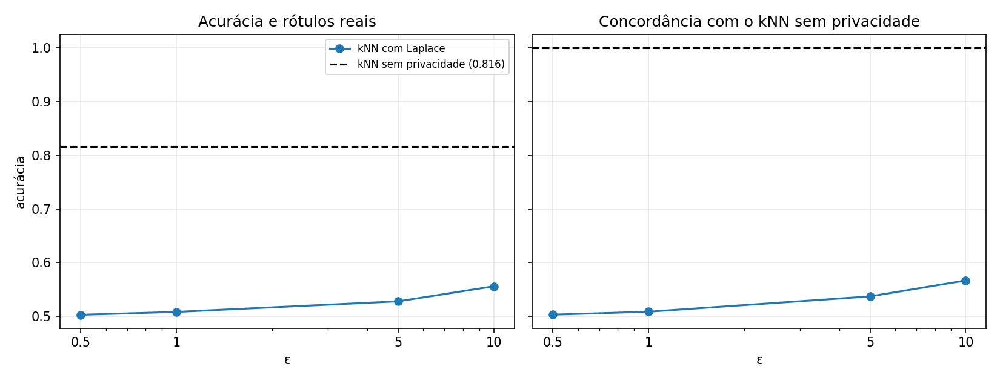

# Trabalho 3 – Privacidade Diferencial (Mecanismo de Laplace) em kNN

Disciplina de Privacidade de Dados – 2026.

## O que o trabalho faz

1. Lê o Adult Income Dataset, remove `fnlwgt`, `education`, `capital-gain`, `capital-loss` e `hours-per-week`, descarta as tuplas com `?` 
2. Divide em 70% treino e 30% teste 
3. Roda o kNN (k = 10, distância euclidiana)
4. Roda o kNN com Laplace para ε ∈ {0,5; 1; 5; 10}, conta os vizinhos de cada classe dentro do raio r = 6, soma ruído de Laplace em cada contagem e escolhe a classe com a maior contagem ruidosa. As contagens ruidosas também são gravadas.

## Ruido

A sensibilidade é 1: tirar ou colocar uma pessoa muda cada contagem em no máximo 1.
 
O ε é dividido pelas 13.567 pessoas do teste e pelas 2 classes: ε' = ε / (13567 × 2). O ruído é Laplace com escala 1/ε'.

| ε | ε' por contagem = ε / (\|Xtest\| · L) | Escala do Laplace = Δ / ε' |
|---:|---:|---:|
| 0,5 | 1,84 × 10⁻⁵ | 54.268 |
| 1 | 3,69 × 10⁻⁵ | 27.134 |
| 5 | 1,84 × 10⁻⁴ | 5.427 |
| 10 | 3,69 × 10⁻⁴ | 2.713 |

## Resultados
O kNN sem privacidade acerta 81,6%.
 
| ε | acerto (rótulos reais) | concordância com o kNN normal |
|---:|---:|---:|
| 0,5 | 0,503 | 0,504 |
| 1 | 0,509 | 0,509 |
| 5 | 0,528 | 0,537 |
| 10 | 0,556 | 0,567 |

No artigo, 1 a 4 é citado como valores razoaveis.

## Grafico

## Analise

Com privacidade, o acerto fica entre 50% e 56%, perto de um chute, e sobe só um pouco com o ε. O motivo é o ruído: o orçamento é dividido entre 13.567 testes e 2 classes, então o ε' de cada contagem é minúsculo e o ruído (2.713 a 54.268) é muito maior que a diferença entre as contagens das classes, que é de centenas. A decisão vira quase um sorteio.
 
Os resultados são de uma execução só, e o erro de amostragem é de uns ±0,004, então ε = 0,5 e ε = 1 não se distinguem do acaso. Além disso, cerca de 75% da base ganha `<=50K`, então responder sempre essa classe já acerta mais que o kNN privado em qualquer ε.
 
Menor ε dá mais privacidade e menos acerto. Aqui o custo ficou alto por causa da divisão do orçamento entre todos os testes. O artigo propõe uma saída (dar o ε inteiro aos testes que não se sobrepõem), que não foi implementada.

## Arquivos de saída (`resultados/`)

| arquivo | conteúdo |
|---|---|
| `pred_knn.csv` | rótulo real e predição do kNN tradicional |
| `pred_dp_eps_<ε>.csv` | rótulo real, predição privada e contagens ruidosas, um arquivo por ε |
| `resumo_acuracia.csv` | acurácia vs. rótulos reais e concordância com o kNN, por ε |
| `grafico_acuracia.png` | gráfico de acurácia por ε com a linha do kNN sem privacidade |

## Observações

- Nenhum atributo é normalizado, porque o raio r = 6 do enunciado é definido sobre os valores inteiros codificados.
- Empate no voto do kNN é resolvido pela classe de menor índice.
- Se nenhum treino cair dentro do raio, as contagens verdadeiras são zero e a decisão sai só do ruído.
